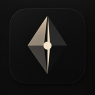
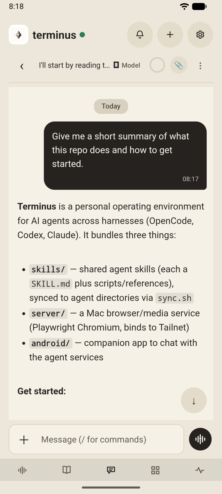
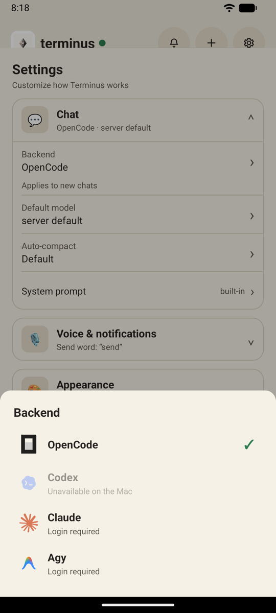
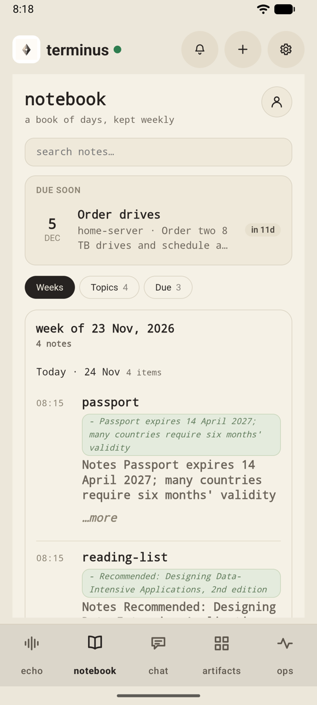
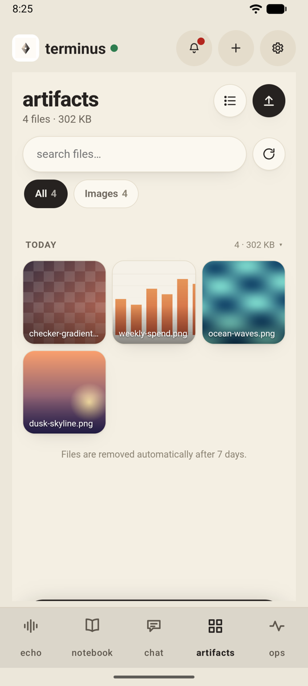
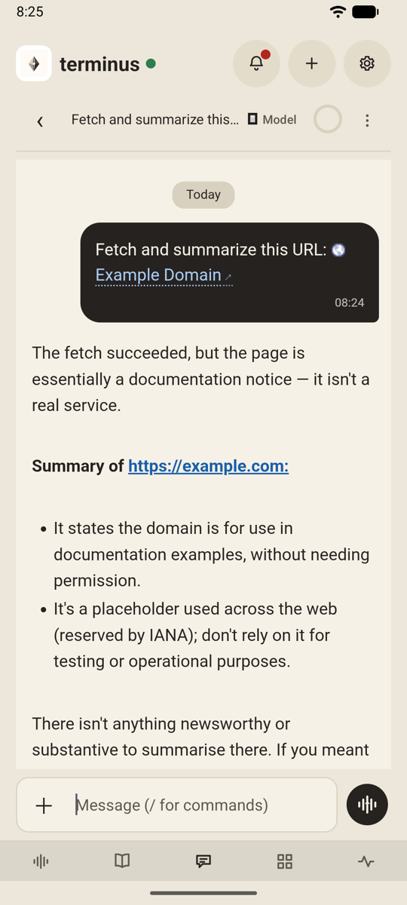
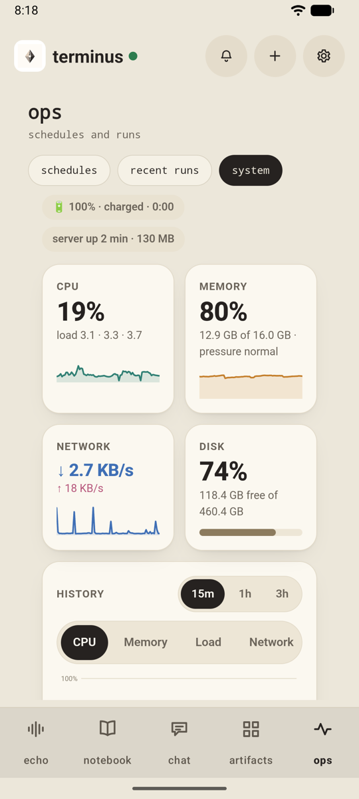

<p align="center">
  
</p>

<h1 align="center">Terminus</h1>

<p align="center">
  A phone-first home for your AI coding agents.<br>
  One chat app, one set of skills, one memory, for OpenCode, Codex, Claude and Agy.
</p>

<p align="center">
  <a href="#what-it-looks-like">Screenshots</a> ·
  <a href="#quick-start">Quick start</a> ·
  <a href="#agent-skills">Skills</a> ·
  <a href="#how-it-fits-together">Architecture</a> ·
  <a href="#license">License</a>
</p>

---

Terminus connects the agent tools you already use to an Android app you can carry around. You run a small server on your Mac, install the app, and chat with your agents from anywhere. They share the same skills, notebook and files no matter which one you pick for a given chat.

It is a personal tool, built to be self-hosted. Your server, your keys, your data.

## What it looks like

<table>
  <tr>
    <td align="center" width="33%"></td>
    <td align="center" width="33%"></td>
    <td align="center" width="33%"></td>
  </tr>
  <tr>
    <td align="center"><b>Chat</b><br>Streaming replies with code, steps and links.</td>
    <td align="center"><b>Backends</b><br>Switch between OpenCode, Codex, Claude and Agy.</td>
    <td align="center"><b>Notebook</b><br>Notes your agents keep, searchable, with due dates.</td>
  </tr>
  <tr>
    <td align="center"></td>
    <td align="center"></td>
    <td align="center"></td>
  </tr>
  <tr>
    <td align="center"><b>Artifacts</b><br>Everything your agents generate, in one gallery.</td>
    <td align="center"><b>Web fetch</b><br>Ask for a page with <code>/fetch</code>; the agent goes and reads it.</td>
    <td align="center"><b>Ops</b><br>Schedules, runs and live stats for the machine behind it.</td>
  </tr>
</table>

Use whichever backend you already have; none of them is required. Backends that are not installed or not signed in on the server show as unavailable in the picker, and the one you choose becomes the default for new chats.

## What you get

- **One chat app for several agents.** Pick OpenCode, Codex, Claude or Agy per chat. Sessions, stop and steer controls work the same way across all of them.
- **Skills you write once.** Each skill is a folder with a `SKILL.md`. `make install` publishes them to every agent environment on your machine, so a new skill shows up everywhere at once.
- **A notebook your agents can use.** Facts, decisions and deadlines are written to plain-text weekly notes, searchable from the phone and from the agents themselves.
- **Artifacts.** Files an agent creates land in a gallery you can browse, search and download from the phone.
- **Web access.** Agents can fetch pages, drive a real browser through Playwright, or use the in-app browser on your phone for pages that need a login.
- **Scheduled jobs and background tasks.** Reminders, recurring reports and long-running jobs report back into the chat when they finish.
- **Voice, location and notifications.** Record voice notes with Echo (the app's recording tab), dictate to chat, share your location for "tell me when I'm near" watchers, and get pings when something finishes.

## Quick start

You need Node 20 or newer, an Android phone or emulator, and at least one agent backend: OpenCode, Codex, Claude or Agy. Whichever one you already use is fine. macOS is the tested platform for the server. It is plain Node, so Linux should work for the chat and gallery, but it is untested, and the scheduler's per-minute ticker uses a macOS LaunchAgent.

**1. Get the code and publish the skills**

```sh
git clone https://github.com/aesrael/terminus-os.git terminus
cd terminus
make install
```

**2. Get a backend ready.** Install and sign in to whichever of these you use. One is enough, and `make deps` shows what is already installed.

| Backend | Setup |
| --- | --- |
| Claude | Install Claude Code (`brew install --cask claude-code`), then run `claude` once to sign in. |
| Codex | `brew install --cask codex`, then `codex login`. |
| Agy | Install the Antigravity CLI from antigravity.google and sign in. |
| OpenCode | `curl -fsSL https://opencode.ai/install \| bash`, then `opencode auth login`. Keep `opencode serve --hostname 127.0.0.1 --port 8093` running; it prints a server password that you pass to Terminus as `OPENCODE_PASS` in the next step. |

**3. Start the Terminus server**

```sh
cd server
npm install
npx playwright install chromium
npm run build
npm run serve            # with OpenCode: OPENCODE_PASS=<password from step 2> npm run serve
```

The server listens on port 9009 and uses bearer-token authentication. By default it accepts connections from this machine only, which is enough for the Android emulator. To reach it from a phone on the same Wi-Fi, start it with `HOST=0.0.0.0` (trusted networks only), and see [Using it on the go](#using-it-on-the-go) for away from home. On first run it creates a token at `~/.config/terminus/browser/token`; you can also set `HEADLESS_TOKEN` yourself. Check that it is up:

```sh
curl "http://127.0.0.1:9009/health?backend=claude"   # or codex, agy, opencode
```

`ok` is true when the server is up, and `backend` is `ok` when the backend you asked about is installed, signed in and ready.

**4. Build and install the app**

You need JDK 17 and the Android SDK. There is no prebuilt APK yet, so you build the app yourself:

```sh
cd android
./gradlew assembleDebug
adb install -r app/build/outputs/apk/debug/app-debug.apk
```

**5. Connect the app.** Open **Settings → Connection** and enter your server URL, and the token from step 3 as the server password. From the Android emulator use `http://10.0.2.2:9009`. From a real phone on the same Wi-Fi, start the server with `HOST=0.0.0.0` and use `http://<your Mac's IP>:9009`. Tap **Test connection**, then **Save changes**. Then open **Settings → Chat → Backend** and pick the backend you set up in step 2. It becomes the default for new chats (OpenCode is the default until you change it), and the dot beside the app name turns green when the server is reachable and that backend is ready.

See [`server/README.md`](server/README.md) for every route, option and environment variable.

## Using it on the go

Away from your Wi-Fi, your phone needs a route to the server. The simplest is [Tailscale](https://tailscale.com), a private network for your own devices:

1. Install Tailscale on the Mac and on the phone, and sign in to the same account.
2. Start the server as usual. When Tailscale is running it also listens on the Mac's Tailscale address, with no extra setting.
3. In the app, set the server URL to `http://<mac-tailscale-ip>:9009` (the address shown in the Tailscale app, or `tailscale ip -4`).

Any other VPN or tunnel works the same way, as long as your phone can reach port 9009. Do not expose the server to the public internet.

## iPhone: the home-screen web app

`web/` is the iPhone version: an Expo web app the server serves at `/app`, installed from Safari with Share → Add to Home Screen. It has chats with live replies, steps, stop and steer, queued and offline messages, model and effort, goals, context and compact; approvals from any screen; notifications with the app closed (Web Push); Echo voice notes saved to the Mac with transcription (whisper.cpp); and Notes, Files and Ops.

iPhone needs HTTPS for notifications and the microphone, so the server also listens on `TERMINUS_TLS_PORT` (default 9443) with a certificate you give it in `TERMINUS_TLS_CERT` and `TERMINUS_TLS_KEY`. A Tailscale certificate (`tailscale cert`) works. Keep it on your tailnet; don't put it on a public hostname.

```
cd web && pnpm install && pnpm build      # → web/dist, served at /app
pnpm dev                                  # Expo on :9010 for UI work
tools/terminus-server/install.sh          # the server as a login item, settings in ~/.config/terminus/server.env
tools/chrome-agent/install.sh             # the agents' own Chrome for Chrome DevTools MCP (127.0.0.1:9222)
```

Sign in once with the server token (`cat ~/.config/terminus/browser/token`); the phone keeps a year-long cookie. Speech to text needs `whisper-cli`, a model at `~/.cache/whisper/ggml-base.en.bin` (or `TERMINUS_WHISPER_MODEL`), and `ffmpeg`.

Browser use, in order: headless Playwright on the Mac, then the agents' Chrome through Chrome DevTools MCP (`TERMINUS_CLAUDE_MCP_CONFIG=server/mcp/claude-browser.json`; add the same server to OpenCode's config), then Claude in Chrome (`TERMINUS_CLAUDE_CHROME=1`, Claude only). See AGENTS.md.

## Agent skills

A skill is a directory with a `SKILL.md` that tells an agent when and how to use it:

```text
skills/<name>/
├── SKILL.md
├── scripts/       # Optional executable helpers
├── references/    # Optional supporting instructions
└── assets/        # Optional skill-specific assets
```

Terminus ships with these:

| Skill | What it does |
| --- | --- |
| `notebook` | Search and update the personal notebook |
| `fetch` | Fetch web pages, escalating to a real or phone browser when needed |
| `browser-mobile` | Drive the in-app browser on your phone |
| `artifacts` | Put generated files in the gallery with a download link |
| `schedule` | Reminders, checks and recurring reports |
| `bg` | Run long tasks in the background and report back |
| `recall` | Pull a relevant past chat into the current one |
| `agentbook` | Per-chat working memory that survives compaction |
| `chat-goals` | Set an objective and keep going until it is done |
| `inbox` | Deliver results into the app from scripts and jobs |
| `location` | Your phone's location, distances and map cards |

To add your own, create `skills/<name>/SKILL.md` with a name and description in its frontmatter, then preview and publish:

```sh
bash tools/sync.sh --dry-run
bash tools/sync.sh
```

`tools/sync.sh` treats this repository as the source of truth for managed skills. Read the dry-run output first: it also removes skill directories from the destinations when they are no longer here.

## How it fits together

```text
 Android app  ──►  Terminus server  ──►  OpenCode / Codex / Claude / Agy
 (chat, notes,     (chat proxy, inbox,      agents using the shared
  files, voice)     gallery, notes, browser) skills/ and notebook/
```

| Path | Purpose |
| --- | --- |
| `android/` | The Android app |
| `server/` | The Terminus server: chat proxy, inbox, gallery, notes and browser automation |
| `skills/` | Agent skills and their helpers |
| `tools/` | Shared utilities |
| `tools/sync.sh` | Publishes managed skills to local agent directories |

The rules agents follow when they need the web, such as which fetch tool to try first and when to use the phone's browser, live in [`AGENTS.md`](AGENTS.md).

## Privacy and permissions

Terminus has no accounts, analytics, crash reporting or ads. The app talks to the server you configure, and that server talks to the agent tools you run. A few features do reach other services:

- **Link chips** show a site icon from Google's favicon service, so Google sees the domain of each link displayed in a chat.
- **Map cards** use OpenStreetMap tiles, fetched through your server rather than by the phone.
- **Agent traffic** goes wherever your chosen backend sends it (OpenCode, Codex, Claude or Agy and their model providers).

The Android app asks for these permissions, each for one feature:

| Permission | Used for |
| --- | --- |
| Internet, network state | Talking to your server |
| Microphone | Echo voice notes and dictation in chat |
| Location, including background | The optional location skill: distance to a place and "tell me when I'm near" watchers |
| Notifications, foreground service, run at boot | Instant replies and alerts without a third-party push service |
| Exact alarms, full-screen intent, vibrate | Wake alarms started from a chat |

## Development notes

- Keep credentials and local runtime state out of the repository. State lives under `~/.config/terminus/` and `.run/`, both ignored by git.
- The notebook is personal data. Weekly notes are plain text under `notebook/` and are git-ignored. `notebook/user.md` ships as an empty placeholder for your profile, and `make install` tells git to ignore your local edits to it. `agentbook/` holds per-chat working notes and is ignored the same way.
- Each tool's own README covers its setup and operations.
- The Android screen logic is split by area. `MainActivity.kt` holds the activity's state and lifecycle, and each `Main<Area>.kt` beside it (for example `MainSend.kt`, `MainThread.kt`, `MainSettings.kt`) holds that area's behaviour as extension functions of `MainActivity`. `MainTypes.kt` has the small types and constants they share.
- Contributions are welcome; see [`CONTRIBUTING.md`](CONTRIBUTING.md) and [`SECURITY.md`](SECURITY.md).

## License

MIT. See [LICENSE](LICENSE).
